<p align="center">
  <a href="https://signcerely.site">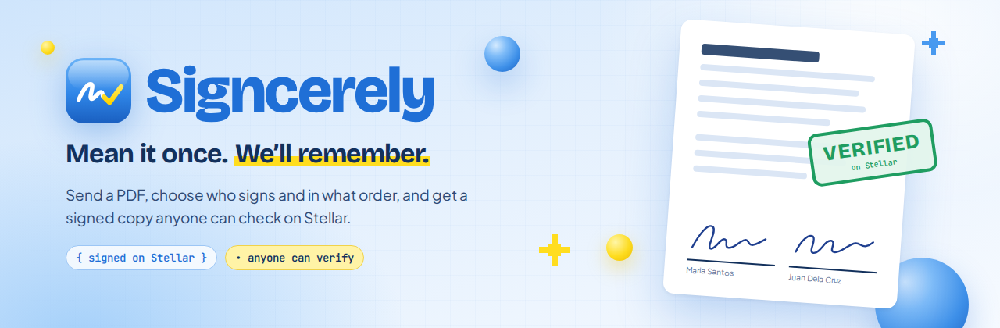</a>
</p>

<p align="center">
  <a href="https://signcerely.site"><b>signcerely.site</b></a>
  &nbsp;·&nbsp; <a href="#how-it-works">How it works</a>
  &nbsp;·&nbsp; <a href="#features">Features</a>
  &nbsp;·&nbsp; <a href="#run-it-locally">Run it locally</a>
  &nbsp;·&nbsp; <a href="#smart-contract">Smart contract</a>
</p>

<p align="center">
  
  
  
  <a href="https://github.com/kylavaloria/signcerely/actions/workflows/app.yml?query=branch%3Amain"></a>
  <a href="https://github.com/kylavaloria/signcerely/actions/workflows/contract.yml?query=branch%3Amain"></a>
  <a href="https://github.com/kylavaloria/signcerely/actions/workflows/e2e.yml?query=branch%3Amain"></a>
  <a href="https://github.com/kylavaloria/signcerely/actions/workflows/testnet-integration.yml?query=branch%3Amain"></a>
  
</p>

### ⭐ Watch the 1-minute pitch

https://github.com/user-attachments/assets/72065a49-d7d2-43a6-ab29-c9c2296fe0ea

<br />

<table>
<tr>
<td width="50%" valign="top">

### ⚠️ The problem

Agreements between freelancers, landlords, small businesses and friends are signed
over email attachments, chat screenshots, or e-signature tools that charge per
document.

When there's a dispute, there's no easy, neutral way to prove **who** signed
**which version** and **when**. The record lives on one company's servers, and a
PDF can be edited after the fact with nobody able to tell.

</td>
<td width="50%" valign="top">

### 💡 The objective

Make signing an agreement as simple as sending an email, while leaving a
permanent, public proof on Stellar that anyone can check for free.

- Send a PDF and choose who signs, and in what order
- Each person signs with their own wallet, and only the invited person can sign their spot
- Everyone gets the final signed copy
- Anyone can upload a copy and confirm it's the exact signed version, no account needed

</td>
</tr>
</table>

<br />

## 📂 Contents

<table>
<tr>
<td width="50%" valign="top">

- [📘 How it works](#-how-it-works)
- [✨ Features](#-features)
- [🔒 Security and privacy](#-security-and-privacy)
- [💠 Architecture](#-architecture)
  - [System](#system)
  - [Signing flow](#signing-flow)
- [💎 Tech stack](#-tech-stack)
- [📁 Repo layout](#-repo-layout)

</td>
<td width="50%" valign="top">

- [🔷 Smart contract](#-smart-contract)
- [⚡ Run it locally](#-run-it-locally)
- [🔹 Testing](#-testing)
  - [Test results](#test-results)
- [🚧 Limitations](#-limitations)
- [🏆 About the builder](#-about-the-builder)
- [📒 License](#-license)
- [Contributing](CONTRIBUTING.md) · [Security policy](SECURITY.md)

</td>
</tr>
</table>

<br />

<a id="how-it-works"></a>

## 📘 How it works

The PDF never goes on-chain. Stellar keeps a small, permanent record: the
fingerprint of the original file, who signed which spot and when, and the
fingerprint of the final signed copy.

<table>
<tr>
<td width="38%" valign="top">

#### 1 · Upload

Drop in a PDF, give it a title and a one-line summary of what people are
agreeing to. Signers will see exactly this file.

</td>
<td>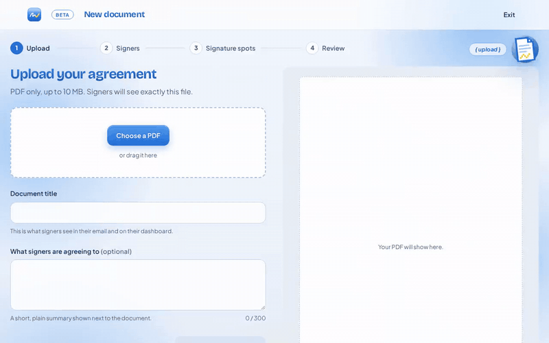</td>
</tr>
<tr>
<td valign="top">

#### 2 · Choose who signs

Add the signers' names and emails, then pick **one after another** (each person
is invited when it's their turn) or **all at once**.

</td>
<td>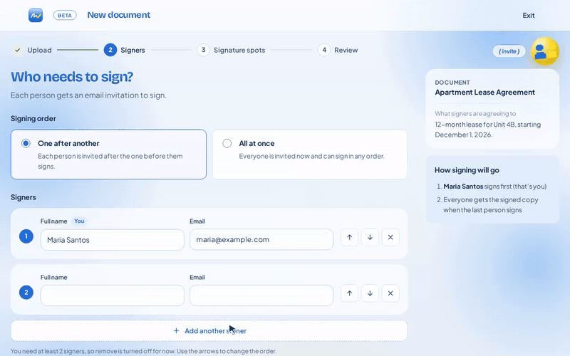</td>
</tr>
<tr>
<td valign="top">

#### 3 · Place signature boxes

Click the page to put each person's box where their signature goes. The date is
added under every signature automatically.

</td>
<td>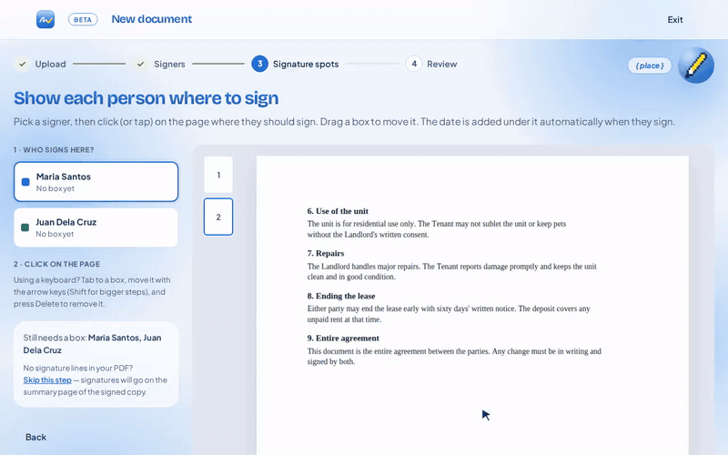</td>
</tr>
<tr>
<td valign="top">

#### 4 · Review and send

Check everything, then approve once in your wallet. The original's fingerprint
is recorded on Stellar and the file is locked, so everyone signs the same version.

</td>
<td>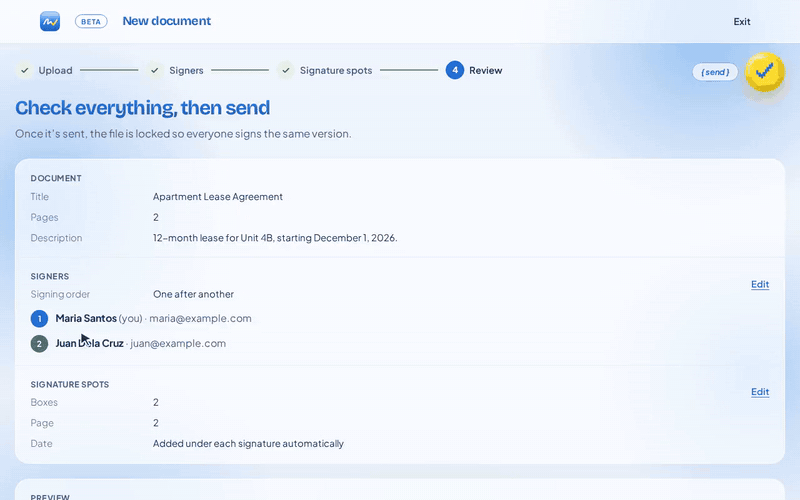</td>
</tr>
<tr>
<td valign="top">

#### 5 · Sign

Each person gets an email when it's their turn, draws or uploads their
signature, and approves it in their Varial wallet.

</td>
<td>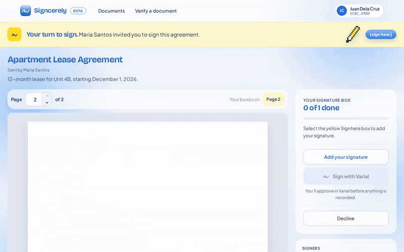</td>
</tr>
<tr>
<td valign="top">

#### 6 · Everyone gets the signed copy

When the last person signs, the final PDF (every signature, date and a summary
page) is created, its fingerprint is recorded, and everyone is emailed.

</td>
<td>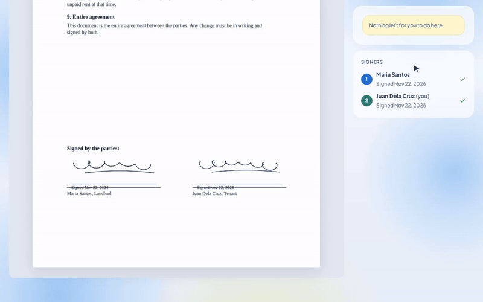</td>
</tr>
<tr>
<td valign="top">

#### 7 · Anyone can verify

Upload a copy on the Verify page. It's checked against Stellar right in the
browser and the file never leaves the device.

</td>
<td>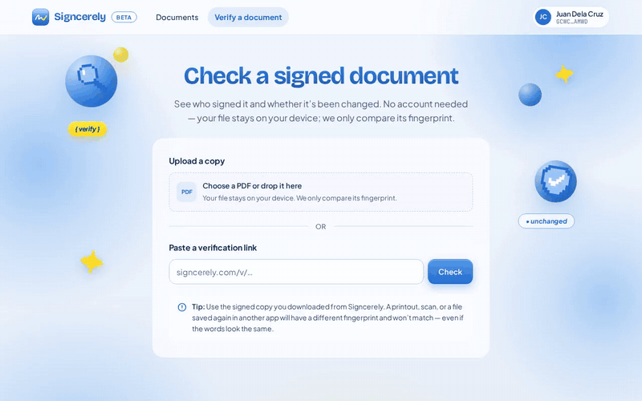</td>
</tr>
</table>

<br />

<a id="features"></a>

## ✨ Features

<table>
<tr>
<td width="50%" valign="top">
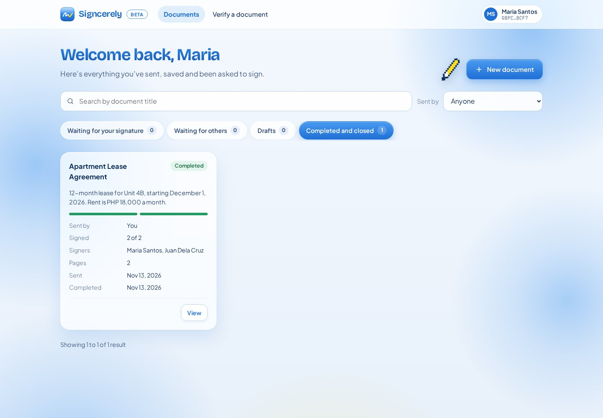
<p><b>One place for everything.</b> Tabs for waiting for your signature, waiting for others, drafts, and completed and closed, with search, a "Sent by" filter and pages of 6.</p>
</td>
<td width="50%" valign="top">
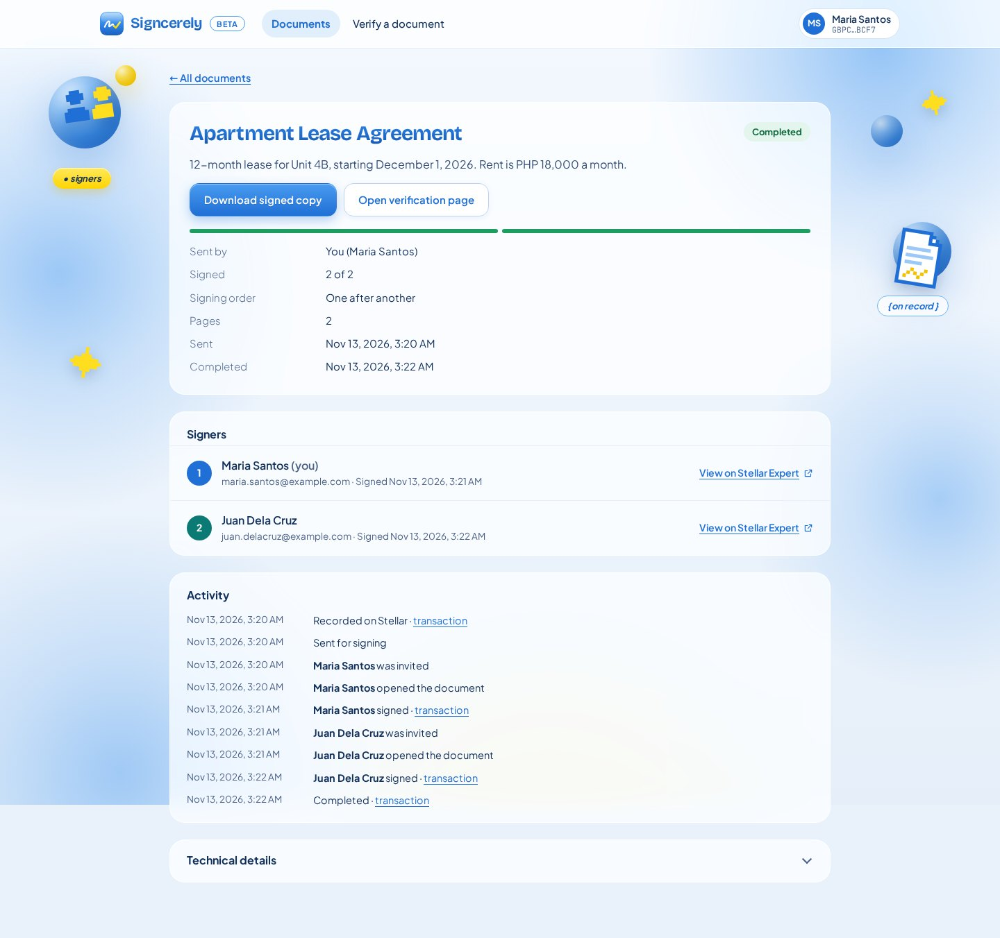
<p><b>Follow every step.</b> See who has signed, who's next, send reminders, copy an invite link, or cancel while it's still waiting.</p>
</td>
</tr>
</table>

| | |
|---|---|
| **Your signature, your way** | Draw it or upload a photo, and save it for next time |
| **Email at every turn** | Invites, "your turn", reminders, declines, cancellations and "everyone has signed" |
| **Signing order** | One after another, or all at once |
| **Signers** | 2 to 20 per document; you can include yourself |
| **Signature boxes** | Placed on any page, or skipped so signatures go on the summary page |
| **Decline** | Signers can decline with a reason; the sender is emailed |
| **Cancel** | Senders can cancel while a document is waiting |
| **Drafts** | Save and come back to any step |
| **Signed copy** | Every signature and date stamped on the PDF, plus a summary page with names, emails and wallets |
| **Verify** | Public page and per-document record page, no account needed |
| **Wallet sign-in** | Sign in by signing a short message in Varial; no password |

<br />

## 🔒 Security and privacy

- **Only fingerprints go on-chain.** The PDF and signature images stay in private storage.
- **Invites are personal.** Each signing spot has a one-time invite key. The link proves the invite was received, and signing also requires the account whose email the invite was sent to.
- **Documents are private.** Only the sender and the invited signers can open a document. Anyone else, signed in or not, sees only who invited whom.
- **One confirmed email per account.** An email address can be confirmed on one account only.
- **One wallet per spot.** The contract binds each spot to the wallet that signed it, and a wallet can't sign twice on the same document.

<br />

## 💠 Architecture

### System

The browser talks to the Next.js server, except for PDF uploads and downloads, which go straight to private storage through short-lived links the server creates. Only the server holds the database key and talks to the contract.

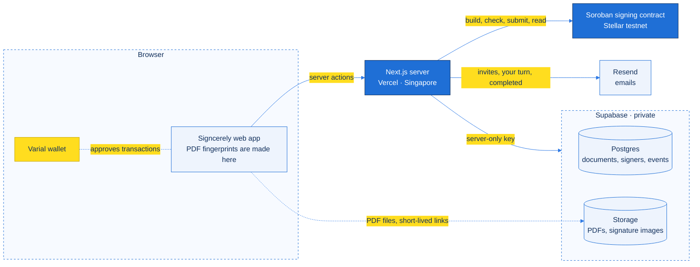

### Signing flow

From sending a document to anyone checking the signed copy.

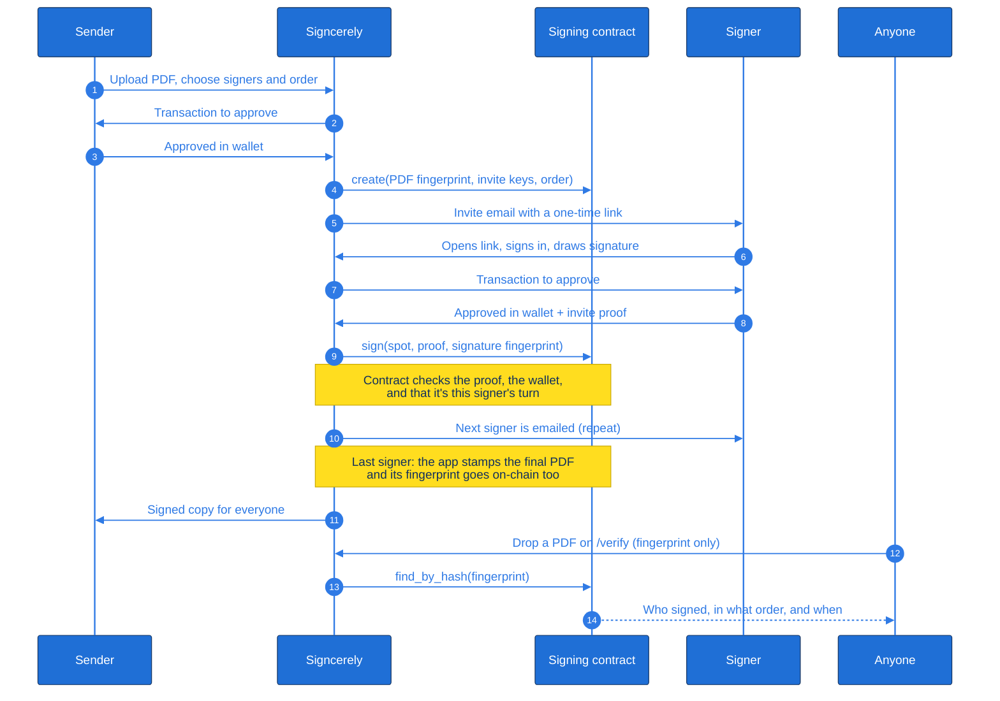

<br />

## 💎 Tech stack

<table>
<tr><td><b>Web app</b></td><td>Next.js 16 (App Router), React 19, TypeScript</td></tr>
<tr><td><b>Blockchain</b></td><td>Stellar Soroban smart contract (Rust, <code>soroban-sdk</code> 28), <code>@stellar/stellar-sdk</code></td></tr>
<tr><td><b>Wallet</b></td><td>Varial (<code>@stellar/varial-sdk</code>)</td></tr>
<tr><td><b>Database and files</b></td><td>Supabase (Postgres + Storage), server-side access only</td></tr>
<tr><td><b>PDF</b></td><td><code>pdf-lib</code> to stamp signatures, <code>pdfjs-dist</code> to preview</td></tr>
<tr><td><b>Email</b></td><td>Resend</td></tr>
<tr><td><b>Hosting</b></td><td>Vercel</td></tr>
<tr><td><b>Tests</b></td><td>Vitest, Rust contract tests, Playwright end-to-end</td></tr>
</table>

<br />

## 📁 Repo layout

| Path | What it is |
|---|---|
| `app/` | Next.js web app |
| `app/e2e/` | End-to-end tests |
| `contracts/signing/` | Soroban smart contract |
| `supabase/` | Database migrations and local config |
| `scripts/` | Contract deploy script |
| `.github/workflows/` | CI: app checks, contract tests, end-to-end, testnet deploy |

<br />

<a id="smart-contract"></a>

## 🔷 Smart contract

| Function | Who calls it | Notes |
|---|---|---|
| `create(sender, doc_id, original_hash, invite_keys, in_order)` | Sender | 2–20 unique invite keys; id and fingerprint must be new |
| `sign(signer, doc_id, slot, invite_proof, image_hash, final_hash?)` | Invitee | `final_hash` only on the last signature; one wallet per document |
| `decline(signer, doc_id, slot, invite_proof)` | Invitee | Stops the document |
| `cancel(sender, doc_id)` | Sender | Only while pending |
| `invite_message(doc_id, slot, signer)` | Anyone (read) | The exact bytes an invite proof signs |
| `get_document(doc_id)` | Anyone (read) | Status, invite keys, fingerprints, times |
| `get_signatures(doc_id)` | Anyone (read) | One entry per slot: wallet, image fingerprint, time |
| `find_by_hash(hash)` | Anyone (read) | `Original(id)`, `Final(id)` or `None` |

Events are emitted for every step: `doc/created`, `doc/signed`, `doc/completed`, `doc/declined`, `doc/cancelled`.

<details>
<summary><b>How invites work on-chain</b></summary>
<br />

People are invited by email and may not have a wallet yet, so the app makes a
one-time invite key per spot. Only its public half goes on-chain; the secret half
is in that person's invite link. When they sign, their browser uses the secret to
sign a short message naming their wallet, and the wallet approves the
transaction. The contract checks both, checks it's their turn, and binds that
wallet to the spot. A copied proof is useless to anyone else because it names the
invitee's wallet.

</details>

**Deployment:** see the contract ID in `.env.example` and on
[Stellar Expert](https://stellar.expert/explorer/testnet/contract/CDS3E7DNMFRC6XOJXK3F5ID32Y36RGR3PAXKZOR3NC3AYSERIO2XQ4ZV).
Each user pays their own small network fee in XLM.

<br />

<a id="run-it-locally"></a>

## ⚡ Run it locally

**Web app** (Node 22):

```bash
cp .env.example app/.env.local   # then fill in the values
cd app
npm install
npm run dev                      # http://localhost:3000
```

You'll need a Supabase project (run the SQL in `supabase/migrations`), a deployed
contract ID, a Resend key for email, and the Varial browser extension set to Test Net.

**Contract** (Rust stable + [Stellar CLI](https://developers.stellar.org/docs/tools/cli)):

```bash
cargo test                       # contract tests
stellar contract build           # build the WASM
./scripts/deploy-testnet.sh      # deploy and print the contract ID
```

No local setup? Open **Actions → Deploy to testnet → Run workflow**.

<br />

## 🔹 Testing

| Command | What it checks |
|---|---|
| `cd app && npm test` | Unit tests (Vitest) |
| `cargo test` | Contract tests |
| `cd app && npm run test:e2e` | End-to-end: a real browser signs documents against a local Supabase and a private Stellar network ([how it's set up](app/e2e/README.md)) |

Every pull request runs lint, type checks, unit, contract and end-to-end tests in CI.
The screenshots in this README come from a real run of the app: **Actions → README screenshots**.

### Test results

<!-- test-results:start -->
| Suite | What it covers | Latest result on `main` | Run |
|---|---|---|---|
| **Unit tests** (Vitest) | Sign-in messages, invite keys, who may sign, document rules, file names, the signed copy, error messages, contract calls | ✅ [passed](https://github.com/kylavaloria/signcerely/actions/runs/45036073682) | Nov 22, 2026 |
| **Contract tests** (Rust) | Signing order, approvals, invite proofs, one wallet per spot, decline, cancel, final fingerprint, events | ✅ [15 passed](https://github.com/kylavaloria/signcerely/actions/runs/43047635787) | Nov 11, 2026 |
| **End-to-end** (Playwright) | A real browser against a local Supabase and a private Stellar network: signing in order through to verify, only the invited person can sign, decline with a reason, one confirmed email per account | ✅ [4 passed](https://github.com/kylavaloria/signcerely/actions/runs/45036073674) | Nov 22, 2026 |
| **Testnet integration** (Vitest) | The real signing flow against the deployed testnet contract | ✅ [passed](https://github.com/kylavaloria/signcerely/actions/runs/45036073685) | Nov 22, 2026 |
| **Lint, types and build** (ESLint, TypeScript, Next.js) | The whole web app | ✅ [no errors](https://github.com/kylavaloria/signcerely/actions/runs/45036073682) | Nov 22, 2026 |

_Updated automatically after every test run on `main`. Click a result to open that run._
<!-- test-results:end -->

<br />

## 🚧 Limitations

- The fingerprint of the final signed copy is supplied by the last signer's app. A wrong value can't fake anyone's signature, but the real signed copy would then not match on Verify.
- Names are typed by the sender and confirmed by each signer; they aren't checked against an ID.
- Copying an invite link from the document page gives the sender that invite's key. The signer's email check still applies.

<br />

## 🏆 About the builder

Signcerely is built by Kyla Mae Valoria, a delivery engineer (software and DevOps) at Tech One Global, a Computer Science graduate of the Polytechnic University of the Philippines, and an active builder in the Stellar Philippines community.

| Milestone | Proof |
|---|---|
| Winner of the Rise In × Stellar "Journey to Mastery" Monthly Builder Challenge for **Paluwagan Go**, a Soroban contract for rotating savings groups. Featured by Stellar Philippines (June 2026). | [Announcement](https://x.com/PHI_Stellar/status/2063946202224427334) · [Repo](https://github.com/kylavaloria/paluwagan-go) · [Live app](https://paluwagan-go.vercel.app/) |
| **Signcerely**: a live app with its signing contract on Stellar testnet, and contract, app and end-to-end tests running in CI. | [signcerely.site](https://signcerely.site) · [Smart contract](#-smart-contract) · [Test results](#test-results) |

<br />

## 📒 License

[MIT](LICENSE). Want to help? See [CONTRIBUTING.md](CONTRIBUTING.md). Found a security problem? See [SECURITY.md](SECURITY.md).
